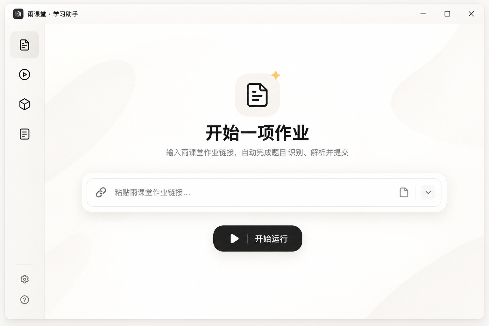

# 雨课堂·学习助手 UI 设计交接稿

状态：八轮讨论形成的暂定方案；2026-10-31 以用户提供的最终效果图校准空闲页。此文档是完整实现目标，当前仅有部分界面原型。交互状态见 [UI_STATES.md](UI_STATES.md)。

2026-11-01 已确认的新视觉基准：[空闲页](assets/ui-concepts-20261101/idle-v1.png)、[运行页](assets/ui-concepts-20261101/running-v1.png)。新版本优先以这两张图校准。运行时的背景和主视觉由内置 imagegen 生成，位于 `yuketang_helper/assets/ui-v2/`；按钮、输入、文字、阶段和详情仍由真实 GUI 组件呈现。素材来源与提示词见该目录的 `SOURCE.md`。

## 1. 设计结论与参考图边界

整体是暖白、黑白灰主导的 Windows 桌面工具。每一状态只设一个视觉中心：空闲时是作业链接输入区，运行时是当前阶段，完成时是结果。通过字号、字重、对比度和留白形成明显层级；次要信息按需展开。不使用蓝紫渐变、玻璃拟态、夸张阴影、宣传卡片或无意义的装饰。用户已明确删除曾出现在底部的四个功能宣传标志。

参考图只定义**作业空闲页**的气质和构图：融合式标题区、左侧图标导航的折叠样态、中央图标与大标题、链接输入框、黑色主按钮、暖白背景与极浅的背景形状。背景形状只可非常克制，不得抢夺焦点。图中不是运行页，不决定任务状态或后台能力。它的“自动完成…提交”辅助文案不得直接照搬：当前自动提交是可选设置，文案应随实际配置变化。

项目内较早的 `7fe73da7-1684-46e8-a1a5-867ba27da3e7.png` 是中间方案，包含常驻右栏和密集结果卡片；以上最终参考与下列交互要求优先。

## 2. 八轮决策摘要

| 轮次 | 已选方向与用户补充 |
| --- | --- |
| 1 | 双栏布局、暖白柔和、适中密度、混合收纳、黑白灰；正常侧栏默认仅显示图标和主标题，悬停才出现副标题。 |
| 2 | 作业极简启动、题目默认折叠、结果优先最终答案、进度混合呈现、主次按钮、柔和悬停。 |
| 3 | 主容器大圆角、区域混合区分、混合排版、黑色实心主按钮、自适应动态反馈、融合式标题栏；动画不能影响响应，文字层级必须明显。 |
| 4 | 空闲中央输入框、适度留白，启动后切换工作区；记忆窗口大小、侧栏自动和手动折叠；运行时聚焦阶段大标题，省略“已完成 4 题”等节点下小字。 |
| 5 | 中央主阶段加小型步骤导航、混合强调、阶段动态生成、主次操作、状态立即更新而动画分层完成；成功为极简完成页，错误按严重度处理。 |
| 6 | 视频页混合布局与动态进度、模型页分组折叠且突出当前模型、日志分级、页面智能过渡、统一主框架。 |
| 7 | 智能链接输入框、轻微按压、偏好与关键配置混合保存、分级错误、仅浅色主题、混合响应式、常用快捷键、辅助信息按场景出现。 |
| 8 | 切页后后台继续并显示全局状态；手动停止保留流程；滚动与流程图尺寸自适应；侧栏响应式与悬停副标题；运行详情在底部按需展开。 |

## 3. 视觉系统

- 参考色：背景 `#F8F7F4`、表面 `#FFFFFF`、次级表面 `#F1F0EC`、分割线 `#E9E7E2`、主文字 `#252525`、次文字 `#777570`。实际在 Windows/Tk 中看效果后微调。主要操作用近黑色底与白字；状态色少量使用且含文字说明。
- 主要容器圆角目标约 14–18px；小控件按尺寸收敛。Tk/ttk 不原生支持某些圆角与透明效果，先验证技术成本，不能为追图牺牲响应或原生窗口行为。
- 主标题明显大于说明文字。内容宽度受控，保留大片自然留白。分割线极细、阴影极轻；避免每个区域都做卡片。
- 中文字体优先清晰、稳定的 Windows 字体回退；在 100%/125%/150% DPI 和窄窗口检查截断、触控目标及滚动。
- 标题栏视觉上与背景融合，但最小化、最大化、关闭、拖动、缩放及系统快捷键必须可靠。优先保留系统标题栏并调整周边视觉；自定义实现需先单独验证。

## 4. 主框架与导航

主框架是左侧导航 + 中央工作区，不设常驻右侧设置栏。**正常宽度**显示图标和主标题，副标题默认隐藏；鼠标悬停时主标题缩小并上移、副标题自下方渐显，约 250ms，移出反向恢复且不推动邻项。**折叠或窄窗口**仅显示图标，悬停给轻量名称提示。最终参考图展示的是折叠样态，不推翻正常宽度下的文字导航决定。侧栏可手动折叠；运行页可显示低显著性的任务标记，切换页面不停止后台任务。

目标导航至少覆盖作业填写、视频播放、模型设置、运行日志。当前工程另有课程流程、记录与经验、期末考试，必须提供可发现的入口并保留功能。具体层级可在导航原型时确定，不能仅照参考图的四个图标删去其他页面。图标服务于识别，不能成为唯一的可访问名称。

## 5. 页面目标

### 作业填写：空闲

中央为功能图标、大标题「开始一项作业」、一句准确说明、智能链接输入框、黑色「开始运行」按钮。聚焦输入框可出现粘贴、清空、历史等操作，但只在真实支持时提供。保留现有单题识别、导出、连续填写、已有答案保留、自动提交、核验继续、浏览器窗口控制等功能；主画面只露出当前最常用操作，其余收纳。启动前校验链接与必要模型设置。

### 作业填写：运行及结束

中央大号文字显示真实当前阶段，例如「获取题目」「识别解析」「模型求解」「填写提交」。小型步骤导航表达整体流程，阶段按实际事件动态出现，不强制每次经过全部阶段。已完成阶段弱化标记，未开始阶段浅灰；不在节点下堆题数、JSON 或耗时。运行保留停止等必要操作；暂停/恢复仅在对应流程实际支持时显示。成功保留极简完成页和下一步操作，不自动返回空闲页；手动停止保留已完成阶段与当前上下文。错误、核验及提交状态不明必须持续可见，不能用装饰动画遮盖。

### 底部详情

底部低显著性入口：题目内容、识别结果、模型说明、参数设置。默认全收起，默认一次只展开一个；切换其他入口时收起前一个。展开从下方进入，中央流程向上移并适当缩小，但维持最小可读尺寸。窄窗口让详情独立滚动，不无限压缩流程。结果优先展示最终答案，解释和原始 JSON 置于更深层；任务快捷参数放底部，完整服务商、密钥和连接设置留在模型设置页。现有设置的保存和确认语义必须保留。

### 其他页面

- 视频播放：空闲时简洁启动；运行时突出当前视频与真实播放进度，多视频列表按需展开。保留倍速、续播、暂停/恢复、最小化和窗口恢复等操作。
- 模型设置：突出当前模型；服务商、连接、API Key、高级配置分组折叠。一般界面偏好可自动保存，关键连接设置明确确认；密钥不明文出现在界面或日志。
- 运行日志：默认重要事件，可切换完整、可复制技术日志。状态分级，不把大段 JSON 放主工作区。
- 课程流程、记录与经验、期末考试：沿用同一视觉语言，但中央布局按各自任务优化。保留课程继续/暂停/停止、做题记录和复盘管理、考试的独立入口与手动交卷提醒。

## 6. 动效、响应式与验收

导航悬停约 250ms；按钮轻微按压且命令立即发出；页面过渡简短；详情展开以非阻塞布局变化实现；流程状态先更新、动画后完成。优先尊重系统减少动画偏好。不得在 Tk 主线程 `sleep()`、频繁重建整个页面，或让动画影响浏览器任务、按钮和窗口缩放。

宽屏保持中央内容宽度与留白；中等宽度压缩间距；窄窗口侧栏自动折叠，详情独立滚动。记忆上次窗口尺寸并设置合理最小尺寸。验收时分别检查空闲、运行、停止、完成、错误、核验待处理、详情展开、侧栏折叠及切页后台继续；每个状态应只有一个明确视觉中心，且当前全部业务操作仍可到达。

## 7. 当前工程约束与实施顺序

入口 `app.py` → `yuketang_helper/gui.py:App`；主页面与详情使用共用 `PageStack`，记录和考试内部用 Notebook 管理内容类别。作业和模型配置仍复用 `HomeworkPanel`。`Engine` 在工作线程执行 Playwright，通过 `queue.Queue` 发事件；`App.poll()` 每约 150ms 处理状态。不改动浏览器控制、OCR、模型调用、提交校验和课程调度。

阶段 0：建立可恢复基线，列出功能与事件映射，运行现有检查。阶段 1：设计常量、导航与窗口原型。阶段 2：作业空闲页。阶段 3：真实事件驱动的运行/结束视图。阶段 4：底部详情与布局联动。阶段 5：其余页面统一。阶段 6：截图、DPI/窗口测试及功能回归。每阶段单独报告并由用户确认后继续大规模实施。

### 当前实现进度

用户确认独立顶栏原型后，已接入 64px 暖白标题栏（`window_chrome.py`）。保留 Windows 的真实顶层窗口、系统菜单、任务栏身份及原生尺寸调整循环，通过窗口子类处理标题区域；不使用 `overrideredirect`，不改后台业务模块。关闭按钮与系统关闭命令沿用 `App.close()`。保留原生侧边与底边缩放边框，最大化客户区限制在显示器工作区，切换回退样式时保持客户区尺寸。使用 `start.ps1 -NativeTitlebar` 或 `YUKETANG_NATIVE_TITLEBAR=1` 可回退；不支持时自动保留原生样式。

验收边界：独立原生窗口测试覆盖最小化、最大化、还原、工作区边界、关闭回调、命中区域、尺寸保持和回退卸载；实际截图使用临时示例数据。桌面交互工具初始化失败，鼠标拖动、贴边、真实多屏 DPI 切换与 Windows 11 最大化悬停布局菜单尚未实测，不将这些列为已验证能力。

补充微调：详情页返回操作统一为深色按钮；模型英文名称使用明确的 Segoe UI Semibold 正体，中文名称保留微软雅黑。视频进度独立放在页面下方，使用圆角轨道、真实位置标记和分开的时间/倍速信息；进度仅由后台事件驱动，不提供拖动跳转。

2026-11-01 第三版修正：工作台以 [新详情页参考](assets/ui-concepts-v3/workbench-reference.png) 重排，导航副标题过渡按用户反馈改为约 135ms，课程流程归入分隔线上方的主功能组。流程连接线仅在真实活动状态播放非阻塞流动动画，停止、阻断与错误状态结束动画。Windows 标题栏统一暖白色，并删除重复的内层标题行；保留系统原生窗口行为，旧系统不支持着色时回退系统样式。

第四版已把暖白样式扩展到课程流程、视频、模型、日志、记录与经验及考试：主视图聚焦当前任务或模型，详情承担配置和操作。六类主图标来自 imagegen 素材表，原有详细操作保留。作业工作台和所有页面的详情使用共用约 180ms 轻微上移过渡，记录、模型高级参数等分组使用同样时长与缓动折叠。动画按实际经过时间计算，可取消反向切换，界面销毁时清理回调。截图使用临时模拟数据，不运行真实课程任务。新参考与提示词见 `docs/assets/ui-concepts-v4/`，界面实图见 `outputs/ui-v4/`。
